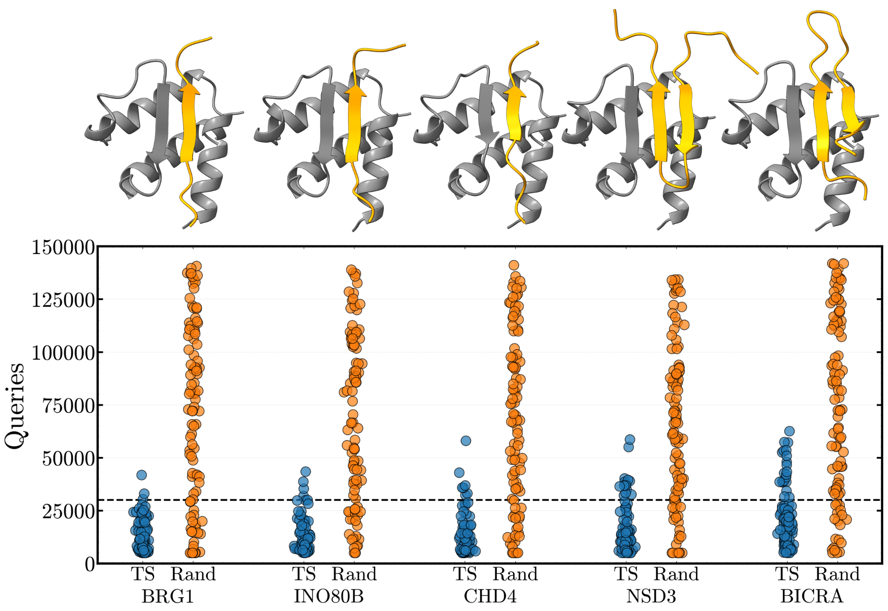

# Thompson Sampling

Cluster-guided Thompson sampling for peptide screening, benchmarked on precomputed AF2 binder labels.



## Inputs

### Cluster assignments

Cluster assignments live in `./clusters` as CSV files with columns:

- `name`
- `sequence`
- `cluster`

Current clustering result files include:

- `cd-0.4.csv`, `cd-0.5.csv`, `cd-0.7.csv`, `cd-0.9.csv`
- `easy-cluster-0.4.csv`, `easy-cluster-0.5.csv`, `easy-cluster-0.7.csv`, `easy-cluster-0.9.csv`
- `easy-linclust-0.4.csv`, `easy-linclust-0.5.csv`, `easy-linclust-0.7.csv`, `easy-linclust-0.9.csv`

### Precomputed AF2 results

`data/dict.csv` stores AF2 metrics with columns:

- `name`
- `sequence`
- `plddt_0`, `dist_0`, `rog_0`
- `plddt_1`, `dist_1`, `rog_1`
- `plddt_2`, `dist_2`, `rog_2`
- `plddt_3`, `dist_3`, `rog_3`
- `plddt_4`, `dist_4`, `rog_4`

The benchmark scripts convert these metrics into a binary binder label (≥ 4 of 5 models with pLDDT ≥ 70 and distance < 20 Å).

## Results

Each section of `results/` has the same layout:

- `data/`: simulation outputs and derived tables
- `work/`: scripts that produce `data/` (SLURM jobs included)
- `plot/`: `N-name.py` draws `figures/N-name.png`
- `figures/`: final figures

Sections: `0-cluster`, `1-policies`, `2-surrogate`, `3-netsolp`, `4-additional`.
Shared simulation code is in `results/scripts/` (`run_experiment.py` and the `tsbench` package).

## Quickstart

Thompson sampling on the CD-HIT 0.5 library, 5 replicates (about 2 min on one CPU):

```bash
cd results/scripts
python run_experiment.py --data ../1-policies/data/library_cdhit_0.5.csv \
    --method ts --k 50 --alloc equal --alpha0 0.01 --beta0 0.99 \
    --seeds 101-105 --out ts_demo.npz
```

Other policies: `random`, `ucb`, `eps_greedy`, `greedy`, `cluster_uniform`. See the docstring of `run_experiment.py` for the output format.

## Dependencies

- `numpy`
- `pandas`
- `matplotlib`
- `scikit-learn` (surrogate models in `2-surrogate` and `4-additional`)
